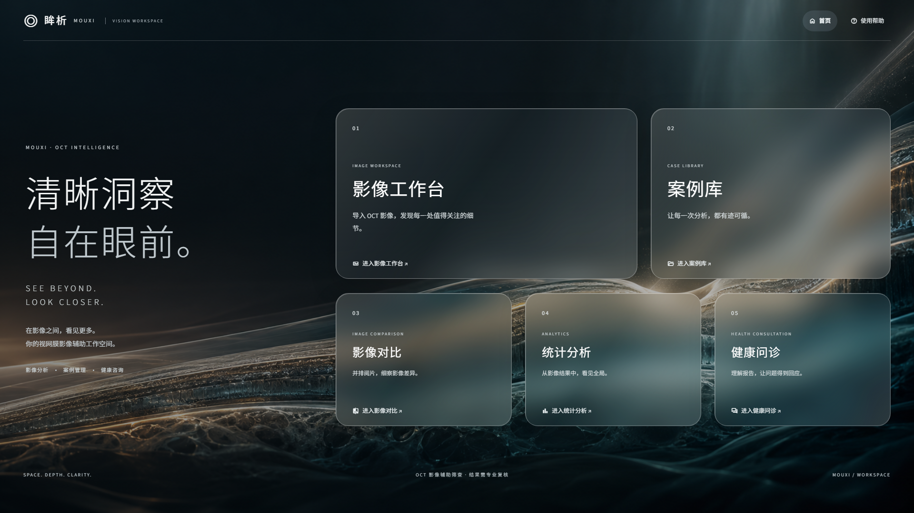
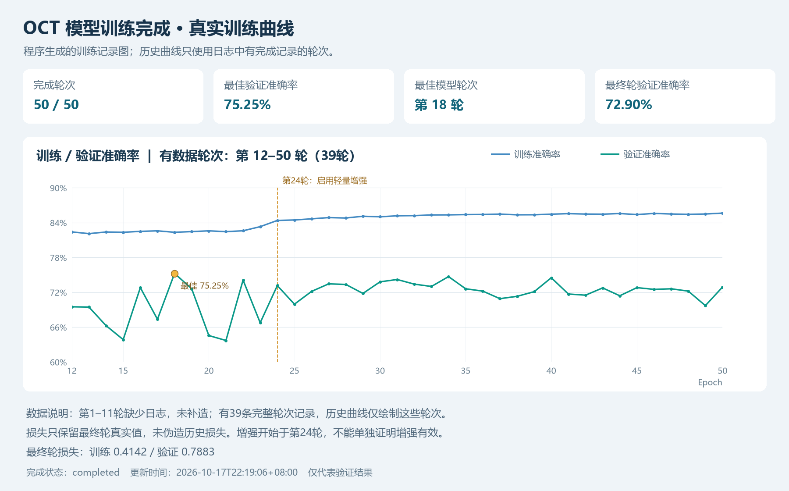

# 眸析 · OCT 视网膜影像辅助筛查工作台

全国大学生数字媒体科技作品及创意竞赛参赛项目。电脑端 Streamlit 工作台，使用已训练的 PyTorch ResNet50 做 CNV / DME / DRUSEN / NORMAL 四分类，提供真实 Grad-CAM 关注图与可下载报告草稿。



## 已实现

- 本地示例或 JPEG / PNG 上传，模型分数表、原图和 Grad-CAM 并排阅片。
- 用户端固定使用最佳检查点 `best.pt`；推理不会启动训练或保存权重。其他检查点仅通过研发命令行选择。
- 调整热图透明度、下载叠加图；没有有效响应时报告错误，不伪造热图。
- 原图/关注图双图对照或单图阅片，支持显示放大、亮度及叠加强度调整；显示操作不会重新预测。
- 带检查编号、四类分数、原图、关注图和阅片备注的离线 HTML / Markdown 报告。HTML 图片内嵌，可用浏览器打印为 PDF；训练指标不进入用户报告。
- 本机持久化案例库：分析后自动保存影像预览、关注图、类别分数及来源指纹，支持搜索、分类、详情、保存备注、报告下载及确认删除。关闭浏览器后仍可查看。
- 上传图片、体验示例，以及根目录 `example/` 图库选图，均执行真实推理。
- 辅助诊断：DeepSeek 参考回答与明确标注的本地回退，病例摘要经确认后发送，不自动发送原图和文件名。
- 人工复核：确认、修正或暂不能判断，追加保存复核依据与版本，报告保留模型提示和人工意见。
- 本机账号：注册、登录、退出、密码加盐哈希、会话过期和失败尝试限制；病例与复核记录按账号独立保存。
- 五入口统一玻璃界面：影像工作台、案例库、影像对比、统计分析、辅助诊断。研发资料保留在独立的 `research_app.py`。

这是研究与比赛演示系统。模型分数是未经校准的 softmax 输出，不代表患病概率；Grad-CAM 是模型关注区域，不是病灶边界、分割或严重程度。分类和报告需由专业人员结合完整检查复核。NORMAL 也不能排除其他疾病。

## 队友如何运行

使用 Python 3.11。PowerShell 中：

```powershell
git clone https://github.com/tmy265372484/oct-screening.git
cd oct-screening
py -3.11 -m venv .venv
.\.venv\Scripts\python.exe -m pip install -r requirements.txt
New-Item -ItemType Directory -Force models/torch_resume
# 从队长处取得可信 best.pt，放到 models/torch_resume/best.pt
.\start_login.bat
```

打开 `http://127.0.0.1:8502`，首次选择“注册账号”后登录。已有项目先 `git pull origin main`，再重新安装依赖并重启服务。

`start_login.bat` 优先使用项目 `.venv`，否则使用已安装的 Python 3.11。只启动系统，不训练模型。账户数据库位于 `outputs/auth/`，各账号病例位于 `outputs/accounts/`，均不提交仓库。原共享病例文件保持原样，不会自动归属新账号。每台电脑的数据独立，不会跨电脑同步。

需要手动启动时，在 PowerShell 设置 `$env:OCT_AUTH_MODE="accounts"`、`$env:OCT_DEPLOYED="0"`，再执行 `python -m streamlit run streamlit_app.py --server.address=127.0.0.1 --server.port=8502`。直接运行主文件而未设置账号模式仍是旧单机模式。不要将本机演示服务直接开放公网。

模型权重约 90 MB / 个，数据集、日志和运行状态不提交 GitHub。缺少权重时界面显示配置提示，不能运行分析。四张脱敏命名的演示切片在 `assets/demo/`，用于功能展示，不是新测试集。

本次最佳检查点 SHA-256：`36712ebe5cd8eb4f4f27dba05bddf18200f7bfd5abe837b78cb337ded0a811da`。收到文件后可用 `Get-FileHash models/torch_resume/best.pt -Algorithm SHA256` 核对。

如需 CUDA，请按照 PyTorch 官方说明安装匹配驱动的 torch 2.5.1 / torchvision 0.20.1；界面默认使用 CPU，命令行支持 `--device cuda`。不要为运行界面重新训练。

## 命令行实验

研发档案独立启动：`python -m streamlit run research_app.py --server.port 8503`。
用户端设计参考与边界见 [桌面工作站设计依据](docs/桌面工作站设计依据.md)。

```powershell
python predict_torch.py --image assets/demo/CNV.png --device cpu --output outputs/prediction.json
python predict_torch.py --examples-dir assets/demo --examples --device cpu
python grad_cam_torch.py --image assets/demo/CNV.png --device cpu --output-dir outputs/gradcam/demo
python evaluate_torch.py --data-dir data/OCT/test --device cpu
python tools/export_training_summary.py
python -m unittest discover -s tests -v
```

命令行和界面使用相同预处理：RGB → 三通道灰度 → 160 × 160 → ToTensor → ImageNet 均值与标准差归一化。Grad-CAM 目标层为 `layer4[-1]`；模型设为 eval，梯度解释不更新权重。只用 `weights_only=True` 读取可信检查点，无不安全 pickle 回退或联网下载模型。

## 当前实验记录

**新增数据审计：** 验证集中303/2000张与训练图字节完全相同，1,993张的候选患者编号与训练集交叉；全数据存在269组相同内容跨类别。应先解决数据质量，再比较训练方法。测试集未发现本次检查范围内的编号或完全重复交叉，但未穷举近重复。详见 [数据审计与误判分析](docs/数据审计与误判分析.md)，独立研发入口 research_app.py 的“数据与误判审查”可下载本机详细案例报告。

2026-10-17 完成 50 / 50 轮训练，最终记录 `phase=completed` 且 `latest.pt` 存在。最佳验证检查点是第 **18** 轮，验证准确率 **75.25%**；第 50 轮验证准确率 **72.90%**。默认推理采用第 18 轮，不能把最佳轮次当成只训练了 18 轮。

训练曲线保留了第 12–50 轮的真实完成日志；第 1–11 轮没有可用逐轮日志，未补造。第 24 轮起采用 `mild_oct_v1` 轻度增强。因为是在同次续训中引入增强，不能据此宣称增强带来了因果提升；需设计相同划分、随机种子与预算的独立对照。

`assets/training_summary.json` 为可共享的实验快照，最佳混淆矩阵来自 2000 张验证图。`assets/test_evaluation.json` 为固定检查点在现有测试目录上的评估。患者划分尚需核验，不能宣称患者独立的临床验证；不应用测试集反复挑模型或调参。演示图分数不是测试准确率。

本次固定 `best.pt` 第18轮对本地 test 的1000张图（每类250张）评估：准确率 **80.70%**，宏平均 F1 **0.7894**。每类召回率：CNV **98.4%**、DME **90.4%**、DRUSEN **42.0%**、NORMAL **92.0%**。DRUSEN 明显漏检是主要短板，不能只报告总体准确率。原始汇总、检查点 SHA256 与混淆矩阵见 `assets/test_evaluation.json`。



## 文件说明

| 文件 | 用途 |
|---|---|
| `streamlit_app.py` / `.streamlit/config.toml` | 电脑端界面、导航、主题 |
| `predict_torch.py` | 检查点加载和统一推理 API / CLI |
| `grad_cam_torch.py` | 真实 Grad-CAM 和对照板导出 |
| `reporting.py` / `app_support.py` | 离线报告、输入检查、脱敏辅助 |
| `evaluate_torch.py` | 固定模型测试、每类指标和混淆矩阵 |
| `train_torch.py` / `train_resume.py` / `training_guard.py` | 原训练、续训与守护源码；界面不调用 |
| `tools/export_training_summary.py` | 从本地日志生成脱敏摘要和曲线 |
| `screenshots/` | 比赛过程截图及图表，见目录说明 |

`train.py`、`predict.py`、`grad_cam.py` 是早期 TensorFlow 方案，依赖单列于 `requirements-legacy.txt`，不是当前入口。原 `models/oct_classifier.keras` 虽然扩展名是 `.keras`，实际是旧 PyTorch state_dict，不能用 Keras 加载。当前系统使用 `torch_resume` 检查点，不覆盖原文件。

尚未实现的患者管理、医生在线咨询、视网膜层分割、多模态融合或 LLM 报告，不描述为已有功能。原在线网页草图只展示设计概念；本仓库的 Streamlit 是真实本地推理系统。

## 数据与截图

数据集：Retinal OCT Images（Kermany2018 / ZhangLab），本地 `data/OCT/`，不入库。`assets/demo/README.md` 记录示例来源。不要上传包含身份信息的病例、密钥、完整数据集或训练权重。

比赛证据区分“实际运行截图”和“程序生成分析图”，详见 `screenshots/实现与实验截图说明.md`。历史截图保留原样。

## 团队分工

| 成员 | 分工 |
|---|---|
| 太梦洋（队长） | 建立仓库、下载数据集、数据预处理、训练模型 |
| 刘坤 | 查找文献、做系统 |
| 孙国宏 | 设计 UI 界面、设计功能 |
| 李琳 | 制作PPT、整合参赛材料、查看重要信息 |

开始协作前先 `git pull`，提交前检查 `git status`，只提交代码、说明和审核后的截图。
